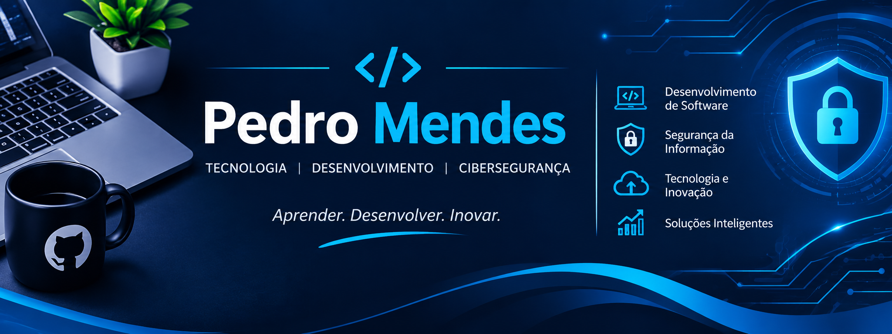

 

# PEDRO MENDES

### CIÊNCIA DA COMPUTAÇÃO | TECNOLOGIA | INOVAÇÃO

## SOBRE MIM

Estudante de Ciência da Computação, interessado em tecnologia, desenvolvimento de software e segurança da informação.

Busco constantemente aprimorar meus conhecimentos em programação, compreender sistemas computacionais e desenvolver soluções eficientes para desafios reais.

Tenho interesse em inovação, resolução de problemas e evolução contínua no universo da tecnologia.

## ÁREAS DE INTERESSE

- Ciência da Computação
- Desenvolvimento de Software
- Cibersegurança
- Segurança da Informação
- Engenharia de Software
- Inteligência Artificial
- Banco de Dados
- Redes de Computadores

## TECNOLOGIAS E FERRAMENTAS

## FORMAÇÃO E APRENDIZADO

Em constante desenvolvimento acadêmico e profissional, aprofundando conhecimentos em:

- Lógica de Programação e Algoritmos
- Estrutura de Dados
- Programação Orientada a Objetos
- Arquitetura de Computadores
- Sistemas Operacionais
- Engenharia de Software
- Segurança da Informação

## OBJETIVO PROFISSIONAL

Desenvolver competências técnicas e analíticas na área da computação, participar de projetos tecnológicos e contribuir para a criação de soluções inovadoras, seguras e eficientes.

---

**PEDRO MENDES**

*Conhecimento, tecnologia e evolução contínua.*

